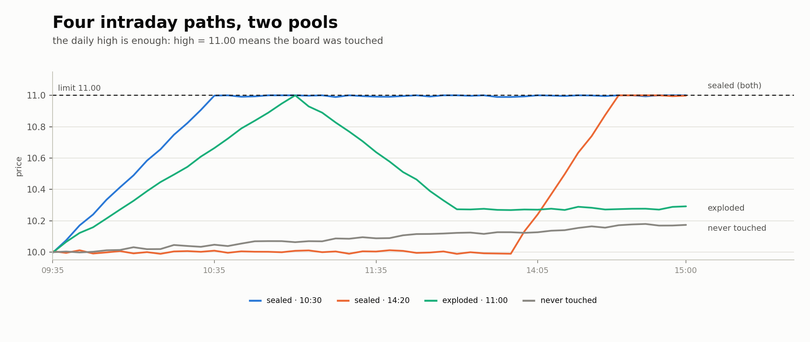
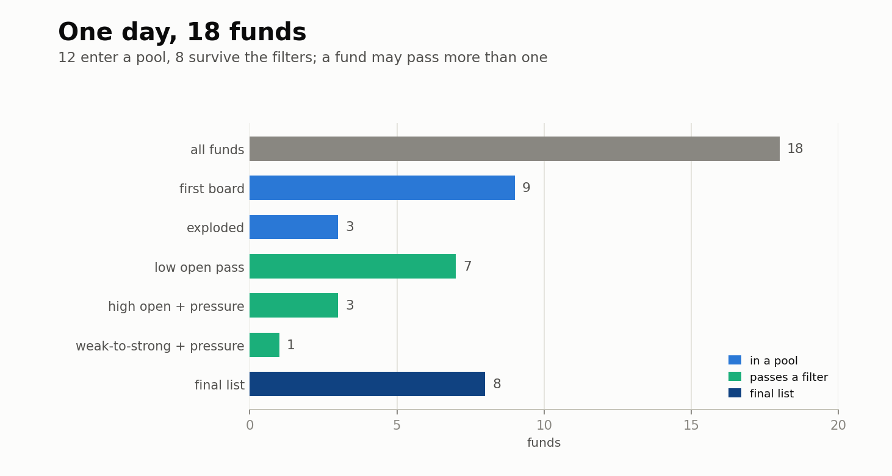
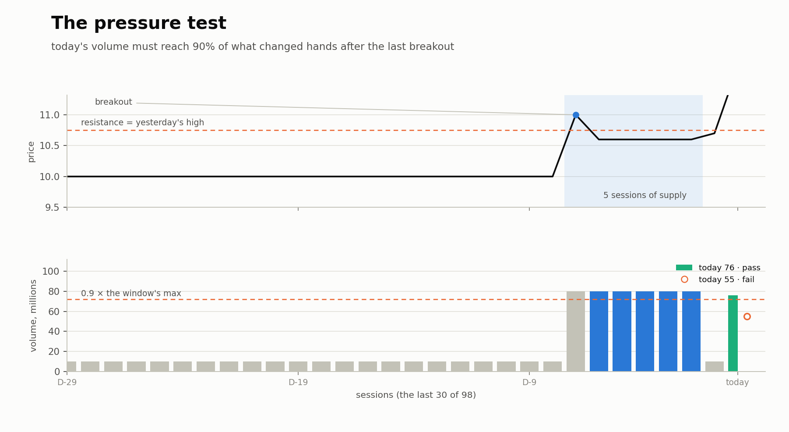

# First-Board Screener

**A-share limit-up pools — and the six defects that make a copied script lie to you.**

Every evening after the close, the job is to split the market into **首板** (first
limit-up: sealed today, not yesterday), **炸板** (touched the board, did not seal)
and **连板** (already sealed yesterday, out of scope), then filter each pool. The
board price is the only hard rule in the whole system — 10% on the main board, 20%
on ChiNext and STAR, 5% on main-board ST — and it is the part that copies get wrong.

A ChiNext ST stock closing +10% is called "sealed" by the usual script. A new
listing up 40% in its uncapped first week is called "sealed" too. And the pressure
test — the last filter — **rejects every stock at a new high**, on the grounds that
it found nothing above it.

Pure standard-library core, 20 tests, four generated figures, and the original
notebook cells preserved verbatim in [`legacy/`](legacy/).

[English](README.md) | [中文](README.zh-CN.md)



---

## What one daily bar already decides

```
close   ≥ limit price            → sealed
high    ≥ limit price, close <   → exploded (touched the board)
neither                          → nothing
```

The 5-minute series that the notebook fetches for every stock exists only to
compute `max(high)` — and the daily bar already carries the high.



### The pipeline

| Stage | Test | Why |
|---|---|---|
| Limit price | board × ST, rounded **half-up** to 0.01 | 5.35 × 1.1 is 5.89, not 5.88 |
| Listing window | no board in the first sessions | STAR/ChiNext are uncapped for five days |
| Previous session | `history[-2]`, not "yesterday minus a weekend" | holidays and suspensions |
| Pools | first board / exploded / continued / unknown | a missing bar is not "was not limit-up" |
| 低开 | `rp ≤ 0.50` over the **prior** 60 days, turnover ≥ 1e8 | not extended |
| 高开 | VWAP premium ≥ 7%, turnover 5.5–20e8, float cap 70–520e8 | closed strong, tradable size |
| 弱转强 | 3-day return ≤ 28%, body ≥ -5%, premium ≥ -4% | an exploded board that recovers |
| Pressure | today's volume ≥ 0.9 × the max after the last breakout | overhead supply |

---

## Quick start

```bash
pip install -r requirements.txt

# Offline: 18 synthetic stocks, the full funnel, four figures. No network.
python examples/demo_boards.py

# Tests (standard library only)
python tests/test_boards.py
python tests/test_strategies.py
python tests/test_pipeline.py
```

Live, against baostock (free, no registration):

```bash
python -m src.limitboard.baostock_source build-pool --out stock_list.csv
python -m src.limitboard.baostock_source scan --pool stock_list.csv --date 2026-11-16
```

As a library, one stock is one series:

```python
from src.limitboard import Bar, Stock, screen

report = screen([Stock(code="sh.600004", name="…", history=tuple(bars),
                       listed_bars=300, cap=Cap(total=200, float_=160))])

report.funnel          # universe → pools → filters → final
report.final           # codes worth a look tomorrow
row = report.rows[0]
row.state              # sealed | exploded | none | no_limit | no_data
row.checks["high_open"].reasons   # e.g. ("amount",)
```

---

## What the demo finds

18 synthetic stocks, one session:

```
all funds            18
no limit window       1      (a STAR listing, day 3)
no board              3
continued             2      (yesterday sealed)
first board           9
exploded              3
low open pass         7
high open pass        4  →  3 through pressure
weak-to-strong        1  →  1 through pressure
final list            8
```

Given the same data, the notebook classifies **4 of the 18 differently**:

| Code | Situation | Notebook | Here |
|---|---|---|---|
| `sz.300007` | ChiNext ST, +10% | first board | nothing (the board is +20%) |
| `sh.688008` | STAR listing, day 3, +40% | first board | no limit window |
| `sh.600010` | first session after a holiday, sealed yesterday | first board | continuation |
| `sh.600012` | pre-close 5.35, close 5.88 | first board | nothing (the board is 5.89) |

And the pressure test on `sh.600006` — a new high with nothing above it:

```
notebook: idx is None -> rejected
here:     new_high     -> pass
```



---

## Bugs this repo fixes

The notebook's three cells are preserved verbatim in [`legacy/`](legacy/).

| # | Defect | Effect | Fix |
|---|---|---|---|
| 1 | `round(preclose * (1 + r), 2)` | Banker's rounding on a binary float. 1.2% of pre-close prices get a board one cent low; a stock closing at that price "seals" while it is still below the real board | `Decimal` + `ROUND_HALF_UP` |
| 2 | `is_st → 5%` for every board | A ChiNext ST stock closing +10% is called sealed; it is ten points away from its 20% board | ratio by board **and** ST status (5 / 20 / 30) |
| 3 | No listing window | A STAR stock up 40% in its first week enters the first-board pool | `no_limit` state for the first sessions |
| 4 | Previous day = "yesterday minus weekends" | On the first session after any holiday the lookup is empty, `prev_limit` is `False`, and **every continuation is filed as a first board** | previous session = the stock's previous bar |
| 5 | 60-day range includes today | A sealed new-high board puts today's close at the top of its own range: `rp = 0`, the filter can never reject | use the prior 60 bars |
| 6 | Pressure test: `if idx is None: continue` | **New highs — the cleanest setups — are rejected** for having no overhead supply | pass with `pressure_note="new_high"` |
| 7 | `total_cap < 70 or float_cap > 520` | The lower bound and the upper bound measure different things; a 600亿-total / 50亿-float stock passes both | one basis, both bounds (`cap_basis`) |
| 8 | `close[-1] / close[-3]` labelled "3-day" | Two sessions, not three | four closes |

Also fixed: the 5-minute query per stock (only `max(high)` was used, and the daily
bar has it); 4–6 queries per stock collapsed into one cached 150-bar history; the
universe scan; output names that carried a timestamp but not the trading date; a
`list(set(...))` that shuffled the final list on every run; and "获利比例" — the
name for a VWAP premium, which is not the share of holders in profit.

Each fix has a test named after it:
`test_limit_price_uses_exchange_rounding`, `test_st_keeps_its_board_limit`,
`test_no_limit_window_for_new_listings`,
`test_missing_previous_bar_is_not_a_first_board`,
`test_relative_position_uses_the_prior_range`, `test_pressure_passes_a_new_high`,
`test_market_cap_band_uses_one_measure`, `test_three_day_return_uses_four_closes`.

---

## Repository layout

```
.
├── src/limitboard/
│   ├── boards.py             # limit price, boards, pools (pure, stdlib)
│   ├── strategies.py         # three filters + pressure test + screen()
│   └── baostock_source.py    # one history fetch, cache, CLI
├── examples/
│   ├── demo_boards.py        # 18 seeded stocks, funnel, figures
│   ├── figures.py
│   └── figures/              # four PNGs
├── legacy/                   # V1, V2, V3 — unmodified
├── notebooks/打板策略.ipynb
├── docs/算法总结.md           # derivations, parameter table, pitfalls (Chinese)
├── docs/公众号文章.md         # long-form write-up (Chinese)
├── tests/
└── requirements.txt
```

---

## Honest limitations

- **No backtest, no trading model.** The code produces a list after the close. It
  contains no entry, exit, size, or stop. It does not know whether you buy at the
  auction, the open, or intraday.
- **"Sealed" does not mean "fillable".** A one-word board has no sellers. The demo
  produces one, and it is rejected by the VWAP filter — but the fill problem is
  separate and unsolved here.
- **Share counts come from the last quarterly report.** Market caps drift after
  splits and placements.
- **Limit prices on ex-rights days** depend on the feed's `preclose`; this repo uses
  unadjusted prices (the correct basis), but the data has to agree.
- **No ST/delisting lifecycle handling.** `isST` is read per bar.
- **Survivorship bias.** The universe is today's listed codes.
- **Tiny samples.** Ten to twenty first boards a day; any conclusion needs years.

Full discussion in [docs/算法总结.md](docs/算法总结.md) (Chinese), section 9.

---

## Data & disclaimer

Market data from [baostock](http://baostock.com), unadjusted (`adjustflag="3"`) —
limit prices are defined on unadjusted quotes. For research and education only.
**Not investment advice.**

## License

MIT
