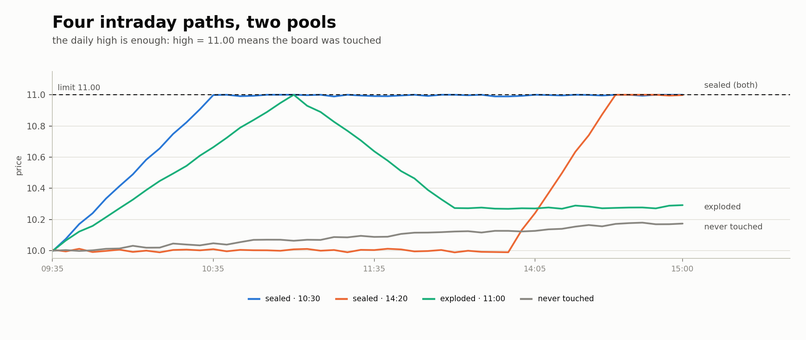
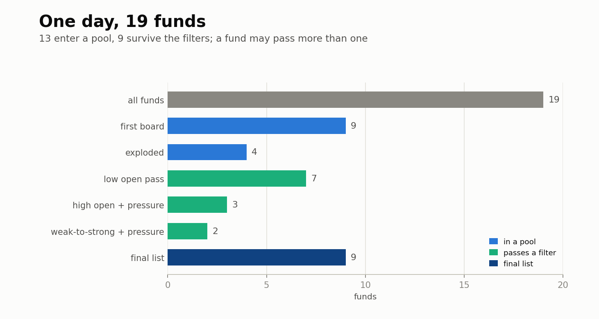
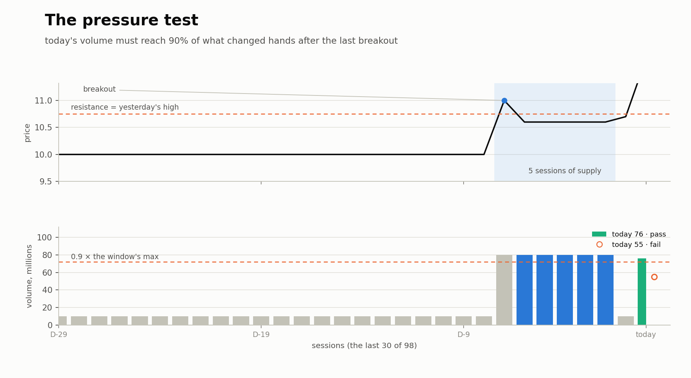
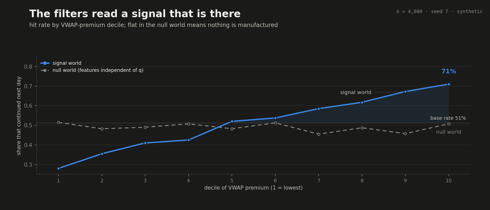
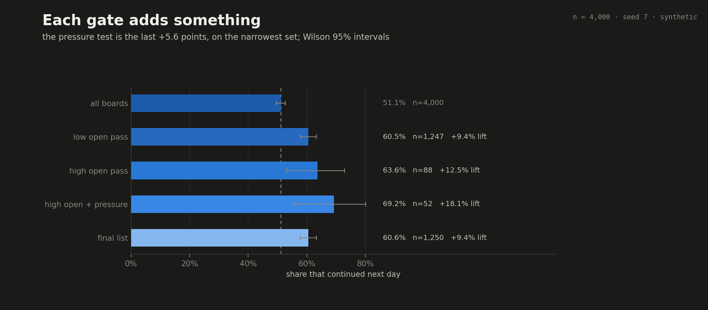
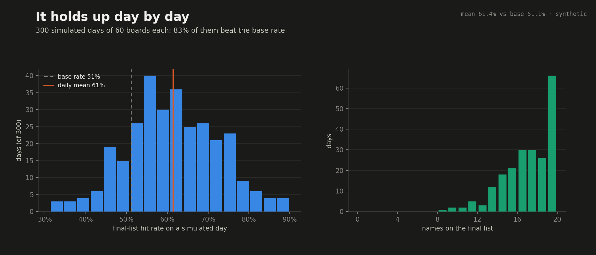
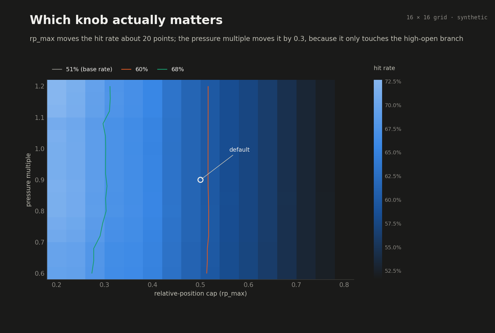

# 首板筛选器

**A 股涨停池——以及一份被抄来抄去的脚本里，六个让结果说谎的缺陷。**

每个交易日收盘后，要做的事是先把市场分成 **首板**（今天封板、昨天没封）、
**炸板**（摸到过涨停、收盘没封）和 **连板**（昨天已封，不在本策略范围），再分别过滤。
整套系统里唯一的硬规则是涨停价——主板 10%、创业板/科创板 20%、主板 ST 5%——
而抄来抄去的版本恰恰错在这里。

创业板 ST 涨 10% 被它算成"封板"；科创板上市第 3 天涨 40% 也被算成"封板"；
而最后一道压力测试，会**把所有创历史新高的股票全部拒掉**，理由是"找不到参照量"。

核心是纯标准库，20 个测试，四张自动生成的图，原始 notebook 的三个版本逐字保留在 `legacy/`。

[English](README.md) | [中文](README.zh-CN.md)



---

## 一根日线已经决定的事

```
收盘价 ≥ 涨停价             → 封板
最高价 ≥ 涨停价，收盘价 <   → 炸板（摸到过）
都不满足                    → 无关
```

notebook 给每只股票额外拉一次 5 分钟线，只为了算 `max(high)`——而日线里就有最高价。



### 流水线

| 阶段 | 判据 | 为什么要有 |
|---|---|---|
| 涨停价 | 板块 × ST，**四舍五入**到分 | 5.35×1.1 = 5.89，不是 5.88 |
| 上市窗口 | 上市初期不判定涨跌停 | 创业板/科创板前 5 日无限制 |
| 前一交易日 | `history[-2]`，不是"日历减一天" | 节假日与停牌 |
| 分池 | 首板 / 炸板 / 连板 / 未知 | 缺一根 K 线 ≠ 昨天没涨停 |
| 低开 | 过去 60 日（不含今天）相对位置 ≤ 0.5，成交额 ≥ 1 亿 | 没有过度展开 |
| 高开 | VWAP 溢价 ≥ 7%，成交额 5.5–20 亿，流通市值 70–520 亿 | 收盘强、盘子可交易 |
| 弱转强 | 三日涨幅 ≤ 28%，实体 ≥ -5%，溢价 ≥ -4% | 炸板后的修复 |
| 压力测试 | 今日量 ≥ 上次突破后 5 日最大量的 0.9 | 上方套牢盘 |

---

## 快速开始

```bash
pip install -r requirements.txt

# 离线：18 只合成股票，完整漏斗 + 四张图。不联网
python examples/demo_boards.py

# 测试（纯标准库）
python tests/test_boards.py
python tests/test_strategies.py
python tests/test_pipeline.py
```

联网（baostock，免费、无需注册）：

```bash
python -m src.limitboard.baostock_source build-pool --out stock_list.csv
python -m src.limitboard.baostock_source scan --pool stock_list.csv --date 2026-11-16
```

作为库使用——一只股票就是一根序列：

```python
from src.limitboard import Bar, Stock, screen

report = screen([Stock(code="sh.600004", name="…", history=tuple(bars),
                       listed_bars=300, cap=Cap(total=200, float_=160))])

report.funnel          # 全部 → 分池 → 过滤器 → 最终
report.final           # 明天的观察名单
row = report.rows[0]
row.state              # sealed | exploded | none | no_limit | no_data
row.checks["high_open"].reasons   # 例如 ("amount",)
```

---

## 离线 demo 发现了什么

19 只合成股票，同一个交易日：

```
全部                  19
无涨跌幅窗口           1      科创板上市第 3 天
非涨停                 3
连板                   2      昨日已封
首板                   9
炸板                   4
策略一通过             7
策略二通过             4  →  过压力 3
策略三通过             2  →  过压力 2
最终名单               9      （用原脚本的压力测试：8）
```

同一份数据交给原脚本，**18 只里有 4 只归类不同**：

| 代码 | 情形 | 原脚本 | 本项目 |
|---|---|---|---|
| `sz.300007` | 创业板 ST，+10% | 首板 | 无关（它的涨停是 +20%） |
| `sh.688008` | 科创板上市第 3 天，+40% | 首板 | 无涨跌幅窗口 |
| `sh.600010` | 节后首日，昨日已封 | 首板 | 连板 |
| `sh.600012` | 前收 5.35，收 5.88 | 首板 | 无关（真涨停价 5.89） |

再看压力测试。`sh.600006` 是创新高的首板：原脚本把它从"高开"分支里拒掉，
但"低开"分支会接住它（`rp < 0` 必然满足 `rp ≤ 0.5`），所以最终名单不受影响。
**真正被这条 bug 杀掉的是炸板池**——那里压力测试是最后一道门：

```
本项目最终名单：      9 只
原脚本（压力测试）：   8 只   （少的那只是 sh.600019，新高炸板）
```



---

## 修了哪些 bug

notebook 的三个 cell 逐字保留在 [`legacy/`](legacy/)。

| # | 缺陷 | 后果 | 修复 |
|---|---|---|---|
| 1 | `round(preclose*(1+r), 2)` | 银行家舍入 + 二进制浮点。1.2% 的前收盘价算出的涨停价低一分，收在该价的股票"被封板" | `Decimal` + `ROUND_HALF_UP` |
| 2 | ST 一律 5% | 创业板 ST 涨 10% 被判封板，离真正的 20% 还差十个点 | 幅度按「板块 × ST」查表（5/20/30） |
| 3 | 无上市窗口 | 次新 +40% 进首板池 | 前几个交易日记 `no_limit` |
| 4 | 前一交易日只跳周末 | 节后第一天查询为空 → `prev_limit=False` → **所有连板被当首板** | 前一交易日 = 上一根有交易的 K 线 |
| 5 | 60 日区间含今天 | 封死的突破型首板 `rp=0`，过滤条件永远成立 | 用今天之前的 60 根 |
| 6 | 压力测试 `idx is None: continue` | 创新高的票被拒；首板有"低开"兜底，**炸板池的弱转强则直接丢失** | 放行，标记 `new_high` |
| 7 | `total_cap < 70 or float_cap > 520` | 下限量与上限量不是同一个 | 统一口径（`cap_basis`） |
| 8 | "近 3 日涨幅"用 3 个收盘价 | 实际是 2 个交易日 | 4 个收盘价 |

另外修掉的：每只股票一次的 5 分钟线请求（只用来取 `max(high)`，日线已有）；
每只 4–6 次查询合并成一次 150 根日线 + 落盘缓存；输出文件名带时间戳却不带交易日；
`list(set(...))` 让最终名单每次顺序不同；"获利比例"这个名字（它其实是 VWAP 溢价，
不是持仓者盈利比例）。

每个修复都有同名测试：`test_limit_price_uses_exchange_rounding`、
`test_st_keeps_its_board_limit`、`test_no_limit_window_for_new_listings`、
`test_missing_previous_bar_is_not_a_first_board`、
`test_relative_position_uses_the_prior_range`、`test_pressure_passes_a_new_high`、
`test_market_cap_band_uses_one_measure`、`test_three_day_return_uses_four_closes`。

---

## 合成基准：能证明什么，不能证明什么

`examples/benchmark.py` 从潜变量 `q`（当天这块板的"质量"）生成 4,000 个样本：
过滤器能看到的每个特征都是 `q` 的含噪函数，次日结果也是。问题变成——
**过滤器能不能把这个 `q` 捞回来，以及在 `q` 不存在时会不会凭空造一个。**



| 集合 | n | 次日续涨 | 提升 |
|---|---:|---:|---:|
| 全部 | 4,000 | 51.1% | — |
| 低开通过 | 1,247 | 60.5% | +9.4 |
| 高开通过 | 88 | 63.6% | +12.5 |
| 高开 + 压力 | 52 | 69.2% | +18.1 |
| 最终名单 | 1,250 | 60.6% | +9.4 |

零假设世界（特征与 `q` 无关）里，最终名单是 49.3%，基准 49.0%——
**没有凭空造出信号**。300 个模拟交易日里，最终名单有 83% 的日子跑赢基准。







响应面还说明了一件不太舒服的事：`rp_max` 能让命中率移动约 20 个百分点，
而压力倍数只移动 0.3——因为压力测试只作用在"高开"这一支上，
而它只占最终名单的 4%。这正是上面那条 bug 的结构性原因。

**这不是回测。** 信号是生成器自己注入的，所以"提升"衡量的是规则能否
捞回**这个**信号，而不是这个信号在 A 股是否存在。能说的只有一句：
几条门的方向是对的，没有泄漏，也不会从噪声里制造优势。

---

## 目录结构

```
.
├── src/limitboard/
│   ├── boards.py             # 涨停价、封板判定、分池（纯标准库）
│   ├── strategies.py         # 三套过滤器 + 压力测试 + screen()
│   └── baostock_source.py    # 一次取数、缓存、CLI
├── examples/
│   ├── demo_boards.py        # 19 只合成股票、漏斗、出图
│   ├── figures.py
│   ├── benchmark.py          # 合成信号回收基准
│   └── figures/              # 八张 PNG
├── legacy/                   # V1 / V2 / V3，原样保留
├── notebooks/打板策略.ipynb
├── docs/算法总结.md
├── docs/公众号文章.md
├── docs/benchmark.md
├── tests/
└── requirements.txt
```

---

## 诚实的局限

- **没有回测，也没有交易模型。** 代码在 T 日收盘后产出名单，**不含任何买卖点、
  仓位、止损**。它不知道你 T+1 是集合竞价买、开盘买还是盘中买。
- **"封板"不等于"买得到"。** 一字板全天没有卖盘。demo 里就有一只，
  它会被 VWAP 过滤器拒掉——但能不能成交是另一个问题，本仓库没有解决。
- **股本来自上一季度报告。** 送转、增发之后市值会失真。
- **除权日的涨停价**取决于数据源的 `preclose`；本项目用不复权价格（这是对的），
  但数据必须一致。
- **不处理 ST / 退市的完整生命周期。** `isST` 按当日数据读取。
- **幸存者偏差。** 股票池是当前上市的代码。
- **样本极小。** 每天 10–20 只首板，任何结论都要几百个交易日。

完整推导见 [docs/算法总结.md](docs/算法总结.md) 第 9 节。

---

## 数据与声明

行情来自 [baostock](http://baostock.com)，不复权（`adjustflag="3"`）——
涨停价的定义建立在不复权价格上。仅供研究与学习，**不构成投资建议**。

## 许可证

MIT
